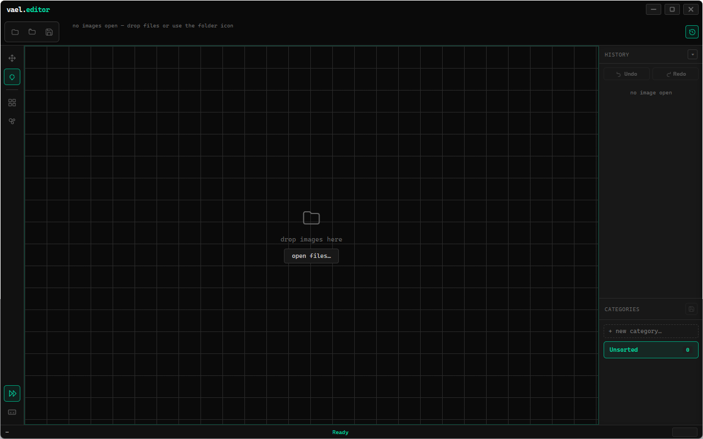

# editor

<!-- cover -->


---

A dark desktop image editor built for one job: pixelating or blurring parts of a large batch of images, fast.

---

## features

- pixelate and bokeh blur with adjustable strength and saved presets
- rectangle, ellipse, and lasso selections, with add/remove selection controls
- import individual images or folders and organize them into categories
- reload folder categories with their ↻ button or “Reload from folder” menu item; pick up disk changes while keeping unsaved edits
- background folder previews, with priority given to the visible category
- load the whole category at full resolution when you select an image, including when Auto Next enters a category; keep it ready throughout the batch
- prepare the whole next category from the start of the current one, for both arrow navigation and Auto Next
- drag thumbnails between categories
- apply filters to selected images and save an entire category
- per-image undo/redo, retained while moving between open images
- queue an exact copy of each edit and immediately advance; encoding and file writing run in background workers while you keep editing
- export PNG, JPEG, or WebP with quality and JPEG background options
- remove source metadata, or retain PNG text such as ComfyUI prompts
- inspect original image metadata
- custom preset shortcuts and an in-app hotkey guide
- hide the controls for a distraction-free canvas
- detect changed files before overwriting and report save failures

---

## installation & removal

**Install from this repository**

1. Install [Node.js](https://nodejs.org/) with its included `npm` tool.
2. Download Vael using **Code → Download ZIP** on GitHub, then extract it.
3. Open the `editor` folder in a terminal. On Windows, open the folder in File Explorer, type `powershell` in the address bar, and press Enter.
4. Run these commands one at a time:

```text
npm install
npm start
```

The first command downloads the app's dependencies and needs internet access. For later launches, open a terminal in the same folder and run `npm start`. This opens a desktop window; opening the HTML file in a browser does not provide the complete app.

**Uninstall**

Close the app and delete its `editor` folder, including `node_modules`. If you installed a packaged Windows version, use **Settings → Apps** to uninstall it; for a Linux AppImage, delete the AppImage. To remove saved preferences too, delete only this app's data folder listed below. Keep any images you have stored inside the installation folder before deleting it.

---

## local data

The app's data folder is named `vael-editor` or `editor.`, depending on whether you launched the repository version or a packaged app.

- **Windows:** press **Win+R**, enter `%APPDATA%`, and find that app folder.
- **Linux:** look under `~/.config/` (or your custom `XDG_CONFIG_HOME`).
- **macOS:** look under `~/Library/Application Support/` if running from source.

Saved filter presets and their shortcuts live in the app folder's `Local Storage` subfolder. This is managed by the app; it is not a text file to edit manually.

Images are written only when you choose **Save** or **Save As**. Saving can replace the source image; Save As lets you choose a separate file. Open categories and editing history are session-only.

Temporary editing data is stored in your system's temporary directory in folders beginning `vael-editor-cache-`. Normal exit removes this cache; an unexpected crash can leave files behind. It is not automatic recovery after restarting.

Entering a category waits for its images to load, with a grey loading overlay, rotating circle, and image count until editing is ready. Already prepared categories open immediately without the overlay. From the start of that category, the editor prepares the entire next category in the background, even with Auto Next off and while edits or background saves are running. Both categories stay in memory; the old 512 MB cache target only reclaims older categories. The status bar shows how many images in the next category are ready. Once preparation finishes, crossing into it needs no image loading. Jumping ahead faster than the files can be read still waits for any remaining images. This trades higher RAM use for smooth batch navigation.

Save captures the current revision and export settings, then Auto Next advances as soon as that copy is queued. Background workers encode and write it without locking editing. You can return to an image, edit it again, and queue another version; writes stay ordered and an older save never marks a newer edit as saved. The status bar shows pending and failed saves. Click it to retry a failed copy, save it elsewhere, or explicitly discard it. A failed copy is retained even if you keep editing.

The queue reserves up to 512 MB for snapshots and encoder working space. If it fills, a new save is declined without advancing or discarding the current edit. Closing the app, removing queued images, and reloading their folders wait until those saves finish or failed copies are resolved. Pending saves are session-only, not crash recovery.

---

## file structure

```text
editor.html           — the interface and editing controls
main.js               — desktop window, file access, and native dialogs
preload.js            — connection between the interface and desktop features
image-files.js        — image formats and safe saving
image-metadata.js     — PNG text metadata handling
session-cache.js      — temporary image and undo-history storage
thumbnail-queue.js    — background preview scheduling
thumbnail-worker.js   — background preview generation
package.json          — app information and launch/package commands
package-lock.json     — exact dependency versions
README.md             — this guide
icon.png / .ico       — app icons
cover.png             — the cover image above
```
