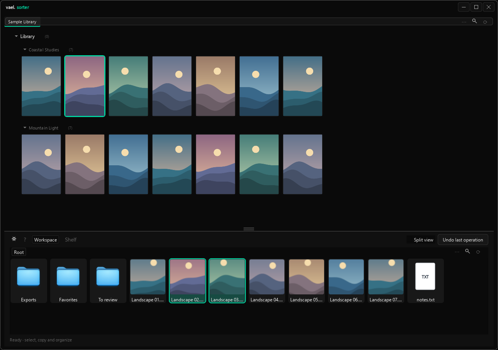

# sorter

<!-- cover -->


---

Browse your content, choose what to use, and organize it in one workspace. Sorter keeps your source folders read-only and gives you a separate place to copy, group, and prepare files.

---

## features

- browse source folders above and organize content below
- use split view to work with two workspace folders
- search by filename or your own folder-naming rules
- group images and attach reusable notes and links
- edit notes and links across several groups at once
- focus on one folder in a temporary full-window view
- undo and redo whole actions, or jump to a point in history
- inspect images, play GIFs and videos, and optionally generate image tags

---

## installation & removal

**Install**

1. Install [Python](https://www.python.org/downloads/) 3.10 or newer. On Windows, enable **Add Python to PATH**.
2. Download Vael using **Code → Download ZIP**, then extract it.
3. Open the `sorter` folder and run `start.bat`. It creates the local environment, installs the required packages, and opens Sorter. Setup needs internet access.
4. Open the **gear** in the lower workspace. Under **Folders**, add your source folders and choose an existing sorting folder.

Use `start_silent.bat` for everyday launches. It uses the installed environment without checking or updating dependencies. Run `start.bat` again for setup, maintenance, or visible error output. The supplied launchers are for Windows.

**Uninstall**

Close Sorter and delete its installation folder, including `venv` and `.local`. Your source and sorting folders stay where you chose them. Move any personal files stored inside the installation folder elsewhere first.

---

## usage

### browse and collect

The upper explorer shows your source folders. Click to select, Ctrl-click to add or remove selections, and double-click an image to inspect it. Source content can be viewed and copied; Sorter only changes files inside your configured sorting folder.

Drag content into the lower workspace to copy it. The destination highlights while dragging. Newly received items stay selected and scroll into view, ready to group.


### organize the workspace

Double-click folders to open them. Use the **Root › Folder** breadcrumbs to go back. Enable **Split view** to show two independent folders side by side.

Right-click files or folders to copy, cut, move, duplicate, rename, inspect, or trash them. Right-click empty space to paste or create folders. Dragging within the workspace moves files; hold **Ctrl** to copy instead.

**Move → To folder…** lets you select several destinations with Ctrl-click. Sorter copies to the extra destinations before moving the original. Its remembered **Images in groups keep their group** checkbox preserves separate groups, notes, and links, including partial groups. Ordinary copies also preserve groups.

When names collide, choose **Auto Rename**, **Overwrite**, or **Cancel**. Auto Rename adds an underscore and number, such as `image10_1.png`.

### groups, notes & links

Select images in one workspace folder, then right-click → **Group selected entries**. Groups appear after folders and before ungrouped files. Their colored backgrounds connect them, and their contents sort alphabetically with natural numbering.

Click a group's colored background to select its visible entries. **Ctrl-click more group backgrounds** to select several groups. You can also select images from different groups. Right-click the selection and use **Selected Groups** to apply a shared link or assign notes to every represented group. Selecting part of a group still edits that whole group's associations.

In the note menu, a partially checked box means only some selected groups have that note. Check it to assign the note to all of them; uncheck it to remove it from all. Other notes stay unchanged. **Dissolve Selected Groups** removes the grouping, not the files.

Open **workspace ⋯ → Group Notes** to create reusable notes with a title and body. Right-click a note to edit or delete it; drag notes or use Move Up/Down to reorder them. The first note is always assigned to every group.

A group's **Copy Note** menu copies a note's body to your clipboard. **Associate Link** saves a link; **Copy Link** copies it. Saving an empty link removes it. Group associations are separate from individual image links and folder tags.

### focus on one folder

Right-click a workspace folder or breadcrumb, including **Root**, and choose **Focus Folder**. That folder fills the app, with its subfolders and normal editing tools available.

All thumbnails in the open folder load in the background and remain cached while you scroll. Changing folders releases the previous folder's thumbnails. The viewer loads full-resolution originals when opened.

Use the **←** at the top left to leave focus mode. Your previous layout, locations, filters, selections of surviving files, and scroll positions return. File changes remain. Focus mode's image cache is released when you leave.

### undo, redo & history

The **← / →** controls beside **History** undo and redo whole actions. Moving 220 files is one history entry, so one Undo reverses that batch. Group creation, dissolution, note assignments, shared links, and edits to the Group Notes library are also recorded.

Open **History**, select a point, and choose **Go to selected point**. Sorter undoes or redoes the intervening actions. Double-clicking an entry does the same. A stopped or partially completed action shows its progress and can be continued through Undo or Redo.

History lasts for the current session. Making a new edit after undoing replaces the future branch. Changing the workspace root starts fresh. Sorter stops if replay would overwrite an unexpected file or discard external changes.

**Trash is handled by the Windows Recycle Bin.** Trashing files starts a new history segment; restore those files through Windows. Image tagging and folder-tag edits are not part of this history.

Sorter temporarily retains overwritten or undone files inside the workspace for history recovery. These private files are hidden from its explorer and removed when the session ends.

### search

Each explorer has its own search and filters. **Searching…** appears immediately, followed by the match count or an error. The **×** resets the search and filters together and restores the unfiltered view.

Ordinary searches match names, containing paths, and recognized fields. For structured folder names, open **Settings → Naming & search**, define fields and aliases, and add a pattern:

| Field | Alias |
| --- | --- |
| GENRE | g |
| CHAR | ch |
| SCENE | s |

For example, `[GENRE]-[CHAR]_[SCENE]` recognizes `Pokemon-Misty_Beach`.

| Search | Meaning |
| --- | --- |
| `Pokemon` | Find Pokemon anywhere |
| `Pokemon g` | Find Pokemon in GENRE |
| `g:Pokemon ch:Misty` | Match both fields |
| `s:"Beach Night"` | Match a phrase |

Matching ignores case. Patterns run from top to bottom; the first match wins. **Test pattern** checks a sample name. Enable inheritance if subfolders should inherit recognized fields from their parents. Field names, aliases, and patterns are yours to choose.

---

## keyboard shortcuts

Shortcuts act on the focused explorer. Text fields keep their normal editing shortcuts. The same list is available at the bottom of Settings.

| Shortcut | Action |
| --- | --- |
| Ctrl+C | Copy selected files or folders |
| Ctrl+X / Ctrl+V | Cut / paste in the workspace |
| Ctrl+Z | Undo the previous action |
| Ctrl+Y / Ctrl+Shift+Z | Redo the next action |
| Alt+C | Close the current folder; workspace: go to its parent |
| Ctrl+Up / Ctrl+Down | Open the previous / next sibling folder |
| Ctrl+A | Select all visible entries |
| Ctrl+F | Open search and filters |
| M | Open Move to Folder for selected images |
| F5 / Alt+Up | Refresh / workspace parent folder |
| F2 | Rename; multiple selections open batch rename |
| Delete | Move selected workspace content to the trash |
| Ctrl+Shift+N | Create workspace folders |

M in the source explorer copies the protected originals rather than moving them.

---

## optional image tagging

Right-click workspace images or folders → **Auto-Tag Image/s**. It tags new or changed content and skips images already tagged, so you can select the whole folder after adding images. Unchanged images need only a quick file check; identical copies reuse saved tags. The progress window shows how many were tagged and skipped. Selected folders include their subfolders, but nothing outside your selection is checked. Tagging never starts automatically.

Use **Re-tag All Selected Images** to deliberately regenerate tags for the selection, for example after changing thresholds or the model. A previously processed image with no generated tags still counts as tagged. Click the tagger status to see progress, stop after the current image, change settings, or inspect errors.

**Copy Tags** copies an image's saved tags. **Associate Tags** on a folder adds reusable tags inherited by its images and subfolders, including images added later. Empty folders are supported. Image tags, folder tags, and image links are saved in `.local/tags.json`.

**Check saved tags…** is a separate, optional maintenance action. After confirmation, it checks all configured folders for changed or moved content. It does not generate tags.

### tagging setup

Tagging needs a compatible local WD14 backend, which is not included in a fresh Vael download.

1. Put the compatible `tagger.py` and its `requirements.txt` in `sorter/wd14-tagger/`. A stock Kohya script is not a drop-in replacement.
2. Open a terminal in `sorter` and run:

   ```powershell
   python -m venv wd14-tagger\.venv
   .\wd14-tagger\.venv\Scripts\python.exe -m pip install -r wd14-tagger\requirements.txt
   ```

3. Keep your existing `wd14-tagger/model-cache/`, or let the compatible backend download its model on first use. Alternatively, select a folder containing `model.onnx` and `selected_tags.csv` in tagger Settings for offline use.

The supported model is WD14 ConvNextV2 (`SmilingWolf/wd-v1-4-convnextv2-tagger-v2`, release `v2.0`). Images are processed locally. Backend software and models retain their own licenses; the local tagger directory is excluded from Git.

For backend authors: provide an import-safe `Tagger(model_dir=None, progress=...)` class with `tags(path, general, character, excluded, separator)` returning a string. Leave saving tags to Sorter.

---

## local data & artwork

Preferences, naming rules, groups, and notes are stored in `.local/settings.json`. Keep a backup of `.local` if these associations matter to you. The catalog cache is disposable; history is session-only. Sorter does not upload or publish content.

Keep artwork beside `app.py`. The README displays **cover.png**. The app tries **icon.ico**, **cover.ico**, **icon.png**, then **cover.png** for its icon. Restart after replacing artwork. Missing artwork does not prevent launch.

---

## license

Part of Vael, licensed under [CC BY-NC 4.0](https://creativecommons.org/licenses/by-nc/4.0/), as described in the repository's main README and LICENSE.
